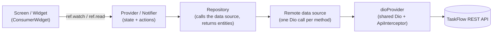

# 00 — Project Map

> **Last audited:** 2026-10-14 · **Updated:** 2026-10-18 (offline mode removed; 15-minute sessions with refresh tokens) · **Scope:** `taskflow_mobile` only
>
> **Verification at audit time:** `flutter analyze` → *No issues found*; `flutter test` → *144 tests passed* (both re-run on 2026-10-18).
>
> Status labels used in all documents:
> - **Confirmed** — read in the source and/or exercised by a passing test.
> - **Inferred** — follows from the source but was not executed.
> - **Unverified** — depends on the backend, a device, or a configuration that this audit could not run.

---

## 1. What TaskFlow mobile is

TaskFlow is a workforce task platform. The **mobile app is the worker's tool**: a worker signs in, sees the tasks assigned to them, starts a task, ticks its checklist, attaches photos/files, writes notes, submits it as completed, comments on it, and gets notified about changes. Admins and managers work in a separate web dashboard (not covered here).

**In one sentence for a manager:** "The app shows each worker only their own tasks, lets them do the work step by step — even without internet — and sends the results back to the server, where the admin sees them live."

---

## 2. Top-level layout

```
taskflow_mobile/
├── pubspec.yaml              Dependencies, assets, launcher-icon config
├── l10n.yaml                 Localization generator config (arb-dir: lib/l10n)
├── analysis_options.yaml     flutter_lints rules
├── lib/                      All Dart source (177 files excl. generated l10n)
├── test/                     9 test files (144 test cases)
├── assets/icons/             taskflow_icon.png (logo + launcher icon source)
├── android/                  Android project (Gradle KTS, manifests, Firebase json)
├── ios/                      iOS project (no Firebase plist, see doc 09)
├── l10n/                     ⚠ stale duplicate of an older lib/l10n (not used by the build)
└── web/ windows/ linux/ macos/  Default Flutter platform folders (not targeted)
```

`l10n.yaml` points the generator at `lib/l10n`, so the root `l10n/` folder is an **unused leftover** (its ARB files differ from the real ones).

---

## 3. `lib/` structure

```
lib/
├── main.dart                     Entry point (doc 02)
├── app/
│   ├── app.dart                  TaskFlowApp: MaterialApp.router, theme, locale
│   ├── router/
│   │   ├── app_router.dart       goRouterProvider: every route + redirect
│   │   └── route_names.dart      Path constants and path builders
│   └── theme/
│       ├── app_colors.dart       Color tokens + readable() contrast helper
│       ├── app_dimensions.dart   Spacing / radius / size tokens
│       ├── app_text_styles.dart  Type scale (Nunito via google_fonts)
│       └── app_theme.dart        Light + dark ThemeData built from tokens
├── core/                         Shared, feature-independent code
│   ├── constants/                api_constants.dart, storage_keys.dart, app_constants.dart (unused)
│   ├── network/                  Dio provider, interceptor (token + refresh), ApiException (+ localization)
│   ├── storage/                  Secure storage (token) + SharedPreferences wrappers
│   ├── notifications/            Firebase bootstrap, FCM service, local notifications
│   ├── utils/date_utils.dart     Local-date helpers
│   └── widgets/                  Reusable UI (buttons, error/empty/loading states…)
├── features/                     One folder per feature (see §4)
└── l10n/
    ├── app_en.arb, app_ar.arb    Source translations
    └── gen/                      Generated AppLocalizations (do not edit)
```

---

## 4. Feature inventory

| Feature folder | What it does | Layers present | Status |
|---|---|---|---|
| `splash` | Branded start screen; decides first destination; shows startup errors with Retry | provider, screen, widgets | **Implemented** |
| `onboarding` | 3 intro pages shown until "Get started"/"Skip" | provider, screen, widgets | **Implemented** |
| `auth` | Login, forgot/reset password (emailed code), request an account (emailed code) | data (remote, models, repo), domain, providers, screens, widgets | **Implemented** (password reset & account request depend on backend email — *unverified on device*) |
| `main_navigation` | Bottom navigation shell (Home, Tasks, Calendar, Profile) | screen | **Implemented** |
| `home` | Greeting, KPI carousel, Due today, My progress; Due-today list screen | provider (derived), screens, widgets | **Implemented** |
| `tasks` | Task list (paged, search, filter), details, start, checklist, attachments, completion, comments | data (remote + local), domain, providers, screens, widgets | **Implemented** |
| `calendar` | Month calendar with task markers, per-day list | provider, screen, widgets, entity | **Implemented** |
| `notifications` | In-app notification list, read state, bell badge, open target | data, domain, providers, screen, widgets | **Implemented** |
| `profile` | Header, edit name, change photo, change password, logout | data, domain, providers, screen, widgets | **Implemented** |
| `settings` | Theme (light/dark), language (en/ar), legal links | provider, screens, widgets | **Implemented** (no notification preferences) |
| `about` | In-app WebView for Terms / Privacy / About | widgets (screen lives in `widgets/`) | **Implemented** |
| `realtime` | Live updates from the server (Server-Sent Events) | data, domain, provider | **Implemented** (needs backend `GET /events`) |

### Placeholders and dead code (found by checking imports)

| File | Finding |
|---|---|
| *(removed 2026-10-14)* 9 empty placeholder files: `core/errors/app_error.dart`, `core/utils/file_utils.dart`, `core/utils/validators.dart`, `features/about/providers/about_provider.dart`, `features/auth/widgets/auth_header.dart`, `email_field.dart`, `password_field.dart`, `features/home/widgets/home_bottom_navigation.dart`, `features/settings/widgets/notification_setting_tile.dart` | Deleted; nothing imported them. `flutter analyze` clean and all tests pass afterwards |
| *(removed 2026-10-18)* offline mode: `core/offline/` (5 files), `features/sync/` (3 files), `task_local_data_source.dart`, `pending_sync_badge.dart`, `logout_pending_dialog.dart` | The app now always talks to the server; with no connection it shows an error with Retry |
| `core/constants/app_constants.dart` | Never imported (e.g. `splashDuration = 2000` is **not** the real splash time — that is `SplashScreen.minimumDuration` = 6 s) |
| `core/widgets/app_background.dart`, `section_header.dart`, `stat_chip.dart` | Never imported |
| `features/auth/domain/entities/task.dart` | Never imported — an old copy of the task entity; the real one is `features/tasks/domain/entities/task.dart` |
| `features/home/widgets/recent_tasks_section.dart` | Never imported (Recent tasks was removed from Home) |
| `features/onboarding/widgets/onboarding_background_painter.dart`, `onboarding_brand_mark.dart` | Never imported |

*How this was determined:* for every file under `lib/`, the audit searched `lib/` and `test/` for an `import 'package:taskflow_mobile/<path>'`. Zero matches = never imported.

---

## 5. Architecture actually used

The code follows a **feature-first, layered architecture** with **Riverpod for dependency injection and state**:



Patterns that are **really present** (with evidence):

| Pattern | Evidence |
|---|---|
| Feature-based folders | `lib/features/<feature>/{data,domain,providers,screens,widgets}` |
| Repository pattern with interfaces | `features/tasks/domain/repositories/task_repository.dart` (abstract) → `data/repositories/task_repository_impl.dart` |
| Remote data source per resource | `task_remote_data_source.dart`, `profile_remote_data_source.dart`, … |
| Dependency injection through Riverpod | every class is created inside a `Provider((ref) => …)` and receives its dependencies via `ref.watch(...)` |
| Reactive state | `AsyncNotifierProvider`s expose `AsyncValue<T>`; screens rebuild with `ref.watch` |
| Single HTTP client | `core/network/dio_client.dart` — *"Single centralized Dio instance. Never create Dio elsewhere."* (the interceptor keeps a second, interceptor-free `Dio` only for `POST /auth/refresh`) |
| Silent token refresh (15-minute access token + rotating refresh token) | `ApiInterceptor` (doc 04 §6) |

No code generation is used (the unused `freezed`/`json_serializable` packages were removed on 2026-10-14). All JSON parsing is **hand-written** in `fromJson` factories (doc 01).

---

## 6. Where to start reading (10 files that explain 80 % of the app)

1. `lib/main.dart` — entry point.
2. `lib/app/app.dart` — app root.
3. `lib/app/router/app_router.dart` — all screens and the auth redirect.
4. `lib/features/splash/providers/splash_provider.dart` — first-destination logic.
5. `lib/features/auth/providers/auth_provider.dart` — login / session / logout.
6. `lib/core/network/dio_client.dart` + `api_interceptor.dart` — every API call passes here.
7. `lib/features/tasks/data/repositories/task_repository_impl.dart` — task data (paging, calendar range).
8. `lib/features/tasks/providers/tasks_provider.dart` — list state and pagination.
9. `lib/features/tasks/screens/complete_task_screen.dart` — the completion flow.
10. `lib/features/realtime/providers/realtime_provider.dart` — live updates from the server.

Next: [01 Dependencies](01_DEPENDENCIES.md) · [02 Startup & navigation](02_STARTUP_AND_NAVIGATION.md) · [14 Study plan](14_STUDY_PLAN.md)
