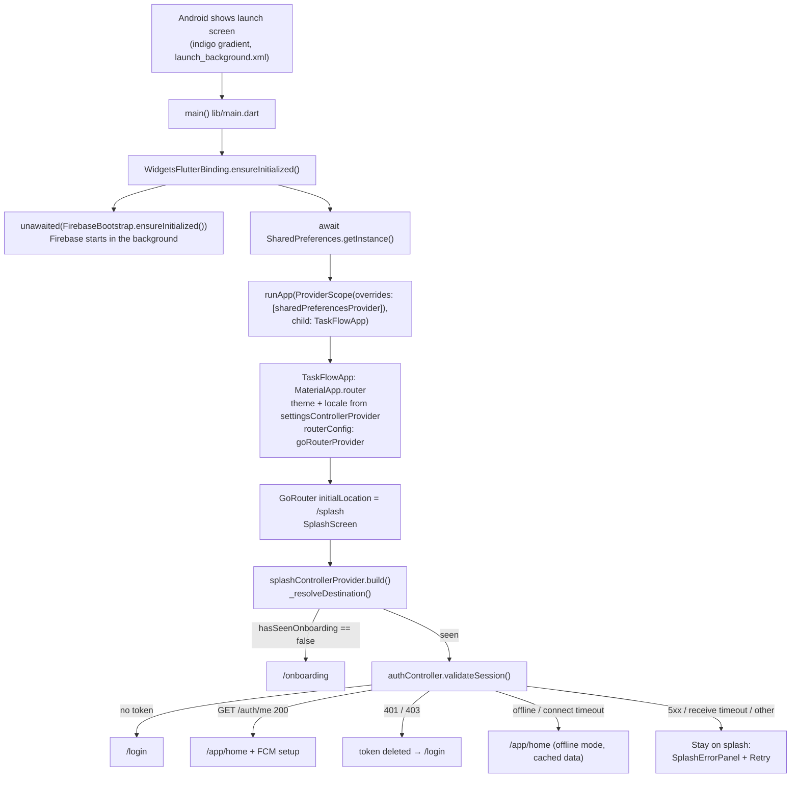

# 02 — Startup and Navigation

> **Last audited:** 2026-10-14. Key files: `lib/main.dart`, `lib/app/app.dart`, `lib/app/router/app_router.dart`, `lib/app/router/route_names.dart`, `lib/features/splash/**`, `lib/features/auth/providers/auth_provider.dart`, `lib/features/auth/data/repositories/auth_repository_impl.dart`.

---

## 1. Startup, step by step



| Step | File · symbol | Why it exists | If it fails |
|---|---|---|---|
| Native launch screen | `android/app/src/main/res/drawable/launch_background.xml`, `values-v31/styles.xml` | Something must show before Flutter draws | — (static) |
| Binding | `main.dart` → `WidgetsFlutterBinding.ensureInitialized()` | Plugins (prefs, Firebase) need the engine ready | — |
| Firebase | `core/notifications/firebase_bootstrap.dart` → `FirebaseBootstrap.ensureInitialized()` | Push notifications. Started **without awaiting** so the splash draws immediately | Returns `false`, logs with `debugPrint`; push is skipped, the app works |
| Preferences | `main.dart` → `SharedPreferences.getInstance()` | Settings, onboarding flag and offline cache must be readable synchronously | Not caught — an exception here would stop startup (*inferred*, very unlikely on a real device) |
| ProviderScope | `main.dart` | Root of Riverpod; injects the loaded prefs via `overrideWithValue` | `sharedPreferencesProvider` throws `UnimplementedError` if not overridden (by design, e.g. in tests) |
| App root | `app/app.dart` → `TaskFlowApp` | Applies theme, dark mode, locale, l10n delegates, router | — |
| Router | `app/router/app_router.dart` → `goRouterProvider` | Single `GoRouter`, `initialLocation: RouteNames.splash` | — |
| Destination | `features/splash/providers/splash_provider.dart` → `SplashController._resolveDestination()` | Decide onboarding / login / home | Errors propagate → `AsyncError` → splash shows `SplashErrorPanel` with Retry (`ref.invalidate(splashControllerProvider)`) |
| Minimum time | `features/splash/screens/splash_screen.dart` → `SplashScreen.minimumDuration = 6 s`; `_shownAt` stopwatch started in a post-frame callback | Branding; counts from the **first drawn frame** so a slow cold start doesn't shorten it | — |

### Onboarding is first-launch only — proven by code
`SplashController` reads `StorageKeys.hasSeenOnboarding` from SharedPreferences; `OnboardingController.markSeen()` (called by both "Get started" and "Skip" in `onboarding_screen.dart → _finish()`) writes `true`. It is never reset by logout. So onboarding appears once per installation (or after clearing app data). **Confirmed** by `test/widget_test.dart` ("App boots: splash, then onboarding on first launch").

### Session restoration — validated, not just "token exists"
`AuthRepositoryImpl.validateSession()`:
1. No token in secure storage → `false` (no network call).
2. Token present → `GET /auth/me` through Dio.
3. Success → `true`. `ApiException` with `isOffline` → **`true`** (offline mode: cached data is shown; the server re-checks later). 401/403 → token deleted, `false`. Anything else (5xx, receive timeout, generic) → **rethrown** so the splash shows an error with Retry.

**Confirmed** by `test/offline_session_test.dart` (3 tests).

### Can startup get stuck?
- Backend down + token saved → *connection refused* is classified **offline** → app opens Home with cached data (or a Home error state with Retry if nothing was ever cached). *Inferred from code.*
- Backend returns 500 → splash stays with an error and Retry. *Inferred.*
- Request hangs → `receiveTimeout` 15 s → timeout error → splash error + Retry. Not stuck indefinitely. *Inferred.*
- No token → no network needed → login. *Inferred* (code path in `validateSession`; not a separate test).

---

## 2. Route table

All paths are in `route_names.dart`; the tree is in `app_router.dart`.

| Path | Screen | Auth required (redirect rule) | Notes |
|---|---|---|---|
| `/splash` | `SplashScreen` | never redirected | initial location |
| `/onboarding` | `OnboardingScreen` | logged-in users are sent to `/app/home` | |
| `/login` | `LoginScreen` | logged-in users are sent to `/app/home` | |
| `/forgot-password` | `ForgotPasswordScreen` | open | |
| `/forgot-password/reset` | `ResetPasswordScreen` | open | email passed as `extra` (String) |
| `/request-account` | `SignupRequestScreen` | open | |
| `/request-account/verify` | `SignupVerifyScreen` | open | `SignupDraft` passed as `extra` (`state.extra!` — see doc 10) |
0| `/app/home` | `HomeScreen` (tab 1) | yes | |
| `/app/home/notifications` | `NotificationsScreen` | yes | opened from the bell |
| `/app/home/due-today` | `DueTodayScreen` | yes | |
| `/app/tasks` | `TasksScreen` (tab 2) | yes | |
| `/app/tasks/:id` | `TaskDetailsScreen` | yes | `?focus=comments` scrolls to comments |
| `/app/tasks/:id/complete` | `CompleteTaskScreen` | yes | |
| `/app/calendar` | `CalendarScreen` (tab 3) | yes | |
| `/app/profile` | `ProfileScreen` (tab 4) | yes | |
| `/app/profile/settings` | `SettingsScreen` | yes | |
| `/app/profile/settings/language` | `LanguageScreen` | yes | |
| `/app/profile/legal/:slug` | `LegalWebViewScreen` | yes | slug = terms / privacy / about |

### The redirect (whole logic)
```dart
// app_router.dart (abridged)
if (isOnSplash) return null;                       // splash decides itself
final auth = ref.read(authControllerProvider);
if (auth.isLoading) return null;                    // no bouncing while unknown
final isAuthenticated = auth.asData?.value ?? false;
if (!isAuthenticated) return isAppRoute ? RouteNames.login : null;
if (isOnLogin || isOnOnboarding) return RouteNames.home;
return null;
```
`_RouterNotifier` listens to `authControllerProvider` and is the router's `refreshListenable`, so the redirect re-runs whenever login state changes.

> **Important nuance:** `AuthController.build()` sets "authenticated" to *"a token exists"*. The redirect therefore trusts token **presence**; token **validity** is only checked by the splash (`validateSession`). A token that expires *during* a session is not detected by the router (see doc 04 §6).

### Bottom navigation
`StatefulShellRoute.indexedStack` with four branches (Home, Tasks, Calendar, Profile). `MainNavigationScreen` renders `navigationShell` plus a `NavigationBar`; `goBranch(index, initialLocation: index == currentIndex)` switches tabs and, when tapping the current tab, returns to its root. Each tab keeps its own back stack (an `IndexedStack` keeps tabs alive). The `SyncStatusBar` sits above the bar.

### Passing data between screens
- **Path parameter:** task id → `state.pathParameters['id']`.
- **Query parameter:** `focus=comments` → `state.uri.queryParameters['focus']`.
- **`extra` object:** reset email (`String`), signup draft (`SignupDraft`). `extra` is in memory only and is lost if the route is restored from a URL.

### Deep links / app links
Not configured: no `<intent-filter>` with a `<data android:scheme=…>` in the Android manifest. The router is only driven from inside the app (and from push taps via `FcmService._open` → `router.go`).

---

## 3. User journeys (traced in code)

| # | Journey | Path through the code | Status |
|---|---|---|---|
| 1 | **First launch** | Splash (6 s) → `hasSeenOnboarding == false` → `/onboarding` → "Get started"/"Skip" → `markSeen()` → `/login` | **Confirmed** (widget test) |
| 2 | **Existing user opens app** | Splash → `validateSession()` → `GET /auth/me` → `/app/home`; `FcmService.initializeForAuthenticatedUser()` runs | Confirmed in unit tests for the repository; full flow *inferred* |
| 3 | **Sign in** | `LoginForm._submit()` validates → `authController.login()` → `POST /auth/login` → token saved → offline data cleared if a different user → providers invalidated → state `AsyncData(true)` → redirect sends `/login` → `/app/home` | *Inferred* (no test drives a real login) |
| 4 | **Open task list** | Tasks tab → `TasksScreen` watches `tasksControllerProvider` → `GET /tasks?page=1&limit=20` | Paging **confirmed** (`tasks_pagination_test.dart`) |
| 5 | **Open a task** | `TaskCard.onTap` → `context.push(RouteNames.taskDetailsPath(id))` → `TaskDetailsScreen` watches `taskDetailsControllerProvider(id)` → `GET /tasks/:id` | *Inferred* |
| 6 | **Start a task** | `TaskActionBar` "Start" → `TaskDetailsController.updateStatus(inProgress)` → `PATCH /tasks/:id/status {status: IN_PROGRESS}` (or queued offline) | Offline path **confirmed** (`offline_sync_test.dart`) |
| 7 | **Complete a task** | "Complete task" → `/complete` → photos/files uploaded as picked → "Submit" → `PATCH /tasks/:id/complete` → pop + snackbar | Offline/queue path **confirmed**; online path *inferred* |
| 8 | **Log out** | Profile → `ProfileLogoutButton` → (`LogoutPendingDialog` if unsent changes) → `signOut()` → `DELETE /me/device-token`, tokens deleted, offline data cleared, providers invalidated → `context.go('/login')` | *Inferred* |
| 9 | **Token expires mid-session** | Requests return 401 → shown as the server's message; not logged out; on next app start splash gets 401 → `/login` | *Inferred*; **limitation** (doc 04) |
| 10 | **Backend unavailable at startup** | No token → login. Token + unreachable → Home in offline mode. Token + 5xx → splash error + Retry | Repository behavior **confirmed** (`offline_session_test.dart`); UI *inferred* |

See [04 Authentication](04_AUTHENTICATION_AND_STORAGE.md) for the auth details and [06 Features](06_FEATURES_WALKTHROUGH.md) for each screen.
