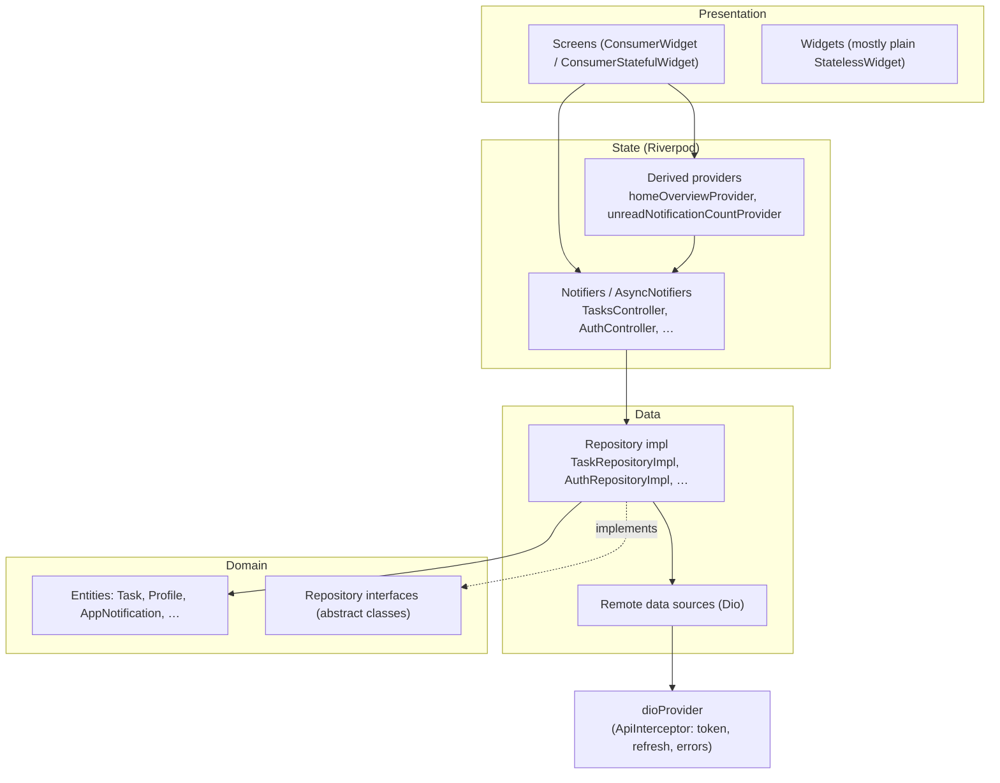

# 03 — Architecture and Riverpod

> **Last audited:** 2026-10-14 · **Updated:** 2026-10-18 (offline mode removed; token refresh added). Riverpod version: `flutter_riverpod 2.6.1` (no code generation, no `riverpod_annotation`). All providers are hand-written.

---

## 1. The layers, as they really exist



| Layer | Responsibility | Example (real file) |
|---|---|---|
| Screen | Watch state, render, forward user actions | `features/tasks/screens/tasks_screen.dart` |
| Widget | Reusable pieces, receive data via constructor | `features/tasks/widgets/task_card.dart` |
| Notifier | Hold state, expose actions (`refresh`, `loadNextPage`, `updateStatus`) | `features/tasks/providers/tasks_provider.dart` → `TasksController` |
| Repository interface | Contract used by notifiers | `features/tasks/domain/repositories/task_repository.dart` |
| Repository impl | Calls the data source; combines calls (e.g. all pages of a month) | `features/tasks/data/repositories/task_repository_impl.dart` |
| Remote data source | One HTTP call per method; JSON → model | `features/tasks/data/datasources/task_remote_data_source.dart` |
| Model | `fromJson`/`toJson` for the API shape | `features/tasks/data/models/task_model.dart` |
| Entity | Plain immutable app object + `copyWith` | `features/tasks/domain/entities/task.dart` |

**Is it "Clean Architecture"?** *Partially.* It has the domain/data split and repository interfaces, but no use-case classes: notifiers call repositories directly. Simpler features (`settings`, `splash`, `onboarding`, `home`, `calendar`) have only providers. Say it honestly: *"feature-first, layered, repository pattern; clean-architecture-inspired without the use-case layer."*

Since offline mode was removed (2026-10-18), repositories are thin: most methods pass straight to the remote data source. They stay because notifiers depend on the interface, which tests replace with fakes.

---

## 2. Provider inventory (39 top-level providers)

Found with a search for `final …Provider =` in `lib/` (re-counted 2026-10-18).

### Infrastructure
| Provider | Type | Purpose | Depends on |
|---|---|---|---|
| `sharedPreferencesProvider` | `Provider<SharedPreferences>` | Throws unless overridden in `main.dart` | — |
| `localStorageServiceProvider` | `Provider` | Wrapper around prefs | sharedPreferences |
| `secureStorageServiceProvider` | `Provider` | Wrapper around `FlutterSecureStorage` | — |
| `dioProvider` | `Provider<Dio>` | The single HTTP client; its `ApiInterceptor` adds the token and renews it | secureStorage (reads `authControllerProvider` only when a session ends) |
| `goRouterProvider` | `Provider<GoRouter>` | Router + redirect | authController |
| `notificationServiceProvider` | `Provider` | Local notifications | — |
| `fcmServiceProvider` | `Provider` | Push token + message handling | dio, notificationService, goRouter |

### Auth / app state
| Provider | Type | Purpose |
|---|---|---|
| `authRemoteDataSourceProvider`, `authRepositoryProvider` | `Provider` | Login / me / logout calls |
| `authControllerProvider` | `AsyncNotifierProvider<AuthController, bool>` | Signed in? + `login`, `validateSession`, `signOut`, `sessionExpired` |
| `passwordResetProvider` | `Provider<PasswordResetActions>` | Forgot / reset password calls |
| `signupRequestProvider` | `Provider<SignupRequestActions>` | Request account + verify code |
| `splashControllerProvider` | `AsyncNotifierProvider<SplashController, String>` | First destination (a route path) |
| `onboardingControllerProvider` | `NotifierProvider<OnboardingController, bool>` | `markSeen()` |
| `settingsControllerProvider` | `NotifierProvider<SettingsController, SettingsState>` | Theme + locale |

### Features
| Provider | Type | Purpose |
|---|---|---|
| `taskRemoteDataSourceProvider`, `taskRepositoryProvider` | `Provider` | Task data |
| `tasksControllerProvider` | `AsyncNotifierProvider<TasksController, List<Task>>` | Paged task list |
| `tasksLoadingMoreProvider`, `tasksLoadMoreFailedProvider` | `StateProvider<bool>` | Footer state for paging |
| `taskDetailsControllerProvider` | `AsyncNotifierProvider.family<…, Task, String>` | One task by id |
| `taskCommentRemoteDataSourceProvider`, `taskCommentRepositoryProvider` | `Provider` | Comments data |
| `taskCommentsControllerProvider` | `AsyncNotifierProvider.autoDispose.family` | Comments of one task |
| `homeOverviewProvider` | `Provider<AsyncValue<HomeOverview>>` | Derived stats from the task list |
| `calendarFocusedMonthProvider`, `calendarSelectedDayProvider` | `StateProvider.autoDispose<DateTime>` | Calendar UI state |
| `calendarMonthTasksProvider` | `FutureProvider.autoDispose.family<List<Task>, DateTime>` | Tasks in one month (`from`/`to`) |
| `calendarEntriesProvider` | `Provider.autoDispose<AsyncValue<Map<DateTime, List<CalendarEntry>>>>` | Tasks grouped per day for the focused month |
| `notificationRemoteDataSourceProvider`, `notificationRepositoryProvider` | `Provider` | Notification data |
| `notificationsControllerProvider` | `AsyncNotifierProvider<NotificationsController, List<AppNotification>>` | List + mark read |
| `unreadNotificationCountProvider` | `Provider<int>` | Bell badge |
| `notificationOpenerProvider` | `Provider<NotificationOpener>` | Where a notification leads |
| `profileRemoteDataSourceProvider`, `profileRepositoryProvider` | `Provider` | Profile data |
| `profileControllerProvider` | `AsyncNotifierProvider<ProfileController, Profile>` | Profile, edit name, avatar, password |
| `realtimeRemoteDataSourceProvider` | `Provider` | Opens the SSE stream |
| `realtimeProvider` | `NotifierProvider.autoDispose<RealtimeController, bool>` | Live updates |

Removed with offline mode: `connectivityProvider`, `offlineStoreProvider`, `offlineFilesProvider`, `syncQueueProvider`, `pendingTaskIdsProvider`, `syncControllerProvider`, `taskLocalDataSourceProvider`.

---

## 3. One complete trace: "Start task"

```mermaid
sequenceDiagram
  actor U as Worker
  participant AB as TaskActionBar
  participant TD as TaskDetailsController(id)
  participant R as TaskRepositoryImpl
  participant RDS as TaskRemoteDataSource
  participant D as Dio + ApiInterceptor
  participant API as Backend
  U->>AB: tap "Start"
  AB->>TD: updateStatus(TaskStatus.inProgress)
  TD->>R: updateTaskStatus(id, inProgress)
  R->>RDS: updateTaskStatus(id, "IN_PROGRESS")
  RDS->>D: PATCH /tasks/:id/status {status}
  D->>D: onRequest adds Bearer token
  D->>API: request
  alt access token still valid
    API-->>D: 200 task JSON
  else access token expired (older than 15 min)
    API-->>D: 401
    D->>API: POST /auth/refresh {refreshToken}
    API-->>D: new access + refresh token (saved)
    D->>API: same PATCH again, new token
    API-->>D: 200 task JSON
  end
  D-->>RDS: Response
  RDS-->>R: TaskModel.fromJson
  R-->>TD: Task
  TD->>TD: state = AsyncData(task); _syncIntoTaskList
  TD-->>AB: rebuild → "Complete task" button appears
```

Code-level notes:
- The widget never touches Dio; it calls a notifier method (`ref.read(taskDetailsControllerProvider(id).notifier).updateStatus(...)`).
- The notifier holds an `AsyncValue<Task>`; the screen uses `.when(data:, loading:, error:)`.
- The token renewal is invisible to every layer above Dio.
- Errors become an `ApiException`; the UI shows `error.localized(l10n)` (`core/network/api_exception_l10n.dart`). With no connection the action fails with "No internet connection" and the user retries.

---

## 4. Riverpod concepts, as used here

| Concept | Meaning | Where in TaskFlow |
|---|---|---|
| `ProviderScope` | Container that stores provider state | `main.dart` (root), every test |
| `Provider` | Read-only value / service object | `dioProvider`, repositories |
| `StateProvider` | Small mutable value | `tasksLoadingMoreProvider`, calendar month/day |
| `Notifier` + `NotifierProvider` | Synchronous state + methods | `SettingsController`, `OnboardingController`, `RealtimeController` |
| `AsyncNotifier` + `AsyncNotifierProvider` | Async state (`AsyncValue<T>`) + methods | `TasksController`, `AuthController`, `ProfileController` |
| `FutureProvider` | One async value, no methods | `calendarMonthTasksProvider` (also `.family` by month) |
| `.family` | One provider instance per argument | `taskDetailsControllerProvider(taskId)`, `taskCommentsControllerProvider(taskId)` |
| `.autoDispose` | Disposed when nobody watches it | comments, calendar, realtime |
| `AsyncValue` | Loading / data / error union | every `AsyncNotifier` state |
| `ref.watch` | Subscribe; rebuild on change | in `build` methods and provider bodies |
| `ref.read` | One-time read, no subscription | in callbacks (`onPressed`), notifier methods, the interceptor's session-ended callback |
| `ref.listen` | Side effect on change | `_RouterNotifier` (auth state → re-run redirect), splash (`listenManual`) |
| `ref.invalidate` | Throw away state; rebuild on next read | `AuthController._clearUserData`, splash Retry |
| `ref.exists` | Is this instance alive? | `RealtimeController._flush` (only reload open task screens) |
| `ref.onDispose` | Cleanup | timers / lifecycle listener in realtime |
| `overrideWithValue` | Replace a provider | prefs in `main.dart`; fakes in tests |
| `AsyncValue.guard` | Try/catch into `AsyncValue` | `TasksController.refresh` |
| `valueOrNull` | Current data or null, never throws | many places (fixed the calendar crash) |

### `ref.watch` vs `ref.read` — the rule used in this code
- In `build()` of a widget/provider → `ref.watch` (reactive).
- In event handlers and async methods → `ref.read` (avoid rebuild loops and stale subscriptions).
- Exception noticed: notifiers read repositories with `ref.read` inside `build()` (e.g. `TasksController.build`). This is fine because repositories don't change at runtime.

### A dependency cycle avoided on purpose
`authControllerProvider` → repository → `dioProvider`, and the interceptor in `dioProvider` must tell the auth controller when a session ends. Watching it there would be a cycle. Instead `dio_client.dart` passes a callback that runs `ref.read(authControllerProvider.notifier).sessionExpired()` **only when it happens** (comment: *"Read when it happens, not here"*).

### Why `AsyncNotifier` and not `FutureProvider` for tasks?
A `FutureProvider` only produces a value. Tasks also need methods (`refresh`, `loadNextPage`, `updateStatus`) that change the same state. `AsyncNotifier` = async value **plus** methods.

### Why `family`?
Each task's details screen needs its own state keyed by id; `taskDetailsControllerProvider('abc')` and `('xyz')` are independent.

### Why `autoDispose` on comments/calendar/realtime?
Their data only matters while their screen is open. Realtime in particular **must** stop when the signed-in shell disappears (logout), and `autoDispose` does that automatically.

### Derived state without duplication
`homeOverviewProvider` = `ref.watch(tasksControllerProvider).whenData(HomeOverview.fromTasks)`. Home statistics are computed from the same list the Tasks tab uses — one source of truth. Trade-off: statistics reflect **only the pages loaded** (see doc 10).

---

## 5. Dependency injection

There is no `get_it`. Every object is created inside a provider and gets its dependencies via `ref`:

```dart
// task_repository_impl.dart
final taskRepositoryProvider = Provider<TaskRepository>((ref) {
  return TaskRepositoryImpl(ref.watch(taskRemoteDataSourceProvider));
});
```

Benefits used in practice: tests replace any layer with `overrideWithValue` (e.g. `tasks_pagination_test.dart` and `realtime_test.dart` substitute a fake `TaskRepository`).

---

## 6. Weak points to admit

| Point | Evidence | Status |
|---|---|---|
| No use-case layer | notifiers → repositories directly | Confirmed |
| Repositories are mostly pass-through since offline mode was removed | `task_repository_impl.dart`, `profile_repository_impl.dart` | Confirmed |
| `fcmServiceProvider` reads `goRouterProvider` (core depends on app layer) | `fcm_service.dart` | Confirmed |
| `dio_client.dart` imports the auth feature (core depends on a feature) for the session-ended callback | `dio_client.dart` | Confirmed |
| Paging footer state lives in two global `StateProvider`s instead of inside `TasksController`'s state | `tasks_provider.dart` | Confirmed |
| Hand-written JSON parsing, no code generation (unused generator packages removed 2026-10-14) | doc 01 | Confirmed |
| `_clearUserData` must be manually updated when a new per-user provider is added (comment says so) | `auth_provider.dart` | Confirmed |
