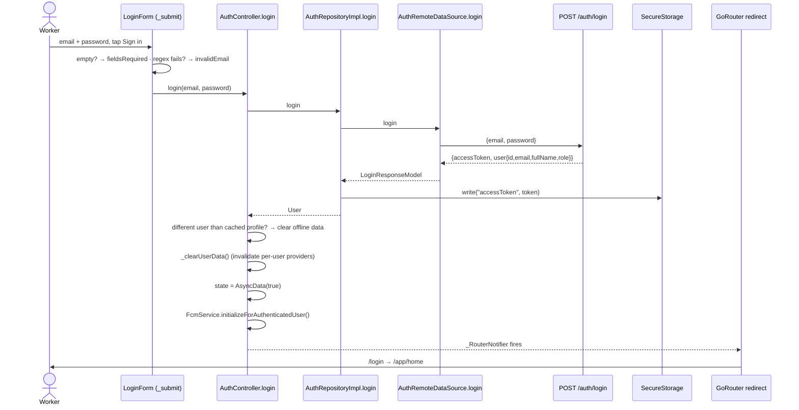
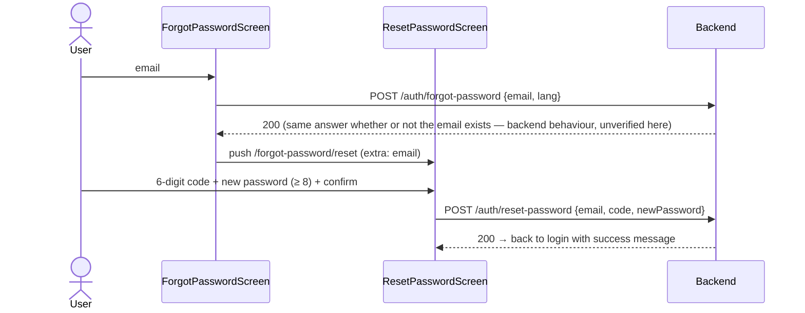

# 04 — Authentication and Storage

> **Last audited:** 2026-10-14. Key files: `features/auth/**`, `core/storage/secure_storage_service.dart`, `core/storage/local_storage_service.dart`, `core/constants/storage_keys.dart`, `core/network/api_interceptor.dart`, `core/offline/offline_store.dart`.
>
> No token or password value appears in this document.

---

## 1. Login flow

| Step | Code | Notes |
|---|---|---|
| Client validation | `widgets/login_form.dart` → `_submit()` | Both fields required; email regex `^[^@\s]+@[^@\s]+\.[^@\s]+$`. No password length rule on login (server decides). |
| Loading state | `_isSubmitting` in `LoginForm` state | Button disabled / spinner while true. |
| Request | `AuthRemoteDataSource.login` → `POST /auth/login` | Body `{email, password}`. |
| Response parsing | `LoginResponseModel.fromJson` | `json['accessToken'] as String` — a missing field throws a `TypeError`, caught by `_submit`'s generic `catch` → "generic error" message. |
| Error display | `on ApiException catch (e)` → `e.localized(l10n)` | Server text (e.g. invalid credentials) is shown as sent; app-side errors (offline/timeout) are translated. |
| Navigation | Not done by the form — comment: *"router will redirect based on auth state"* | Redirect rule: authenticated on `/login` → `/app/home`. |
| Account switch | `AuthController.login` compares `offlineStore.readMap('profile')['id']` with the new user id | Same user → keeps unsent offline changes (e.g. re-login after expiry). Different user → wipes queue, cache, kept files. **Confirmed** in source. |

**Role check:** the app does **not** restrict login by role (no `role ==` check in the auth flow). Role is only displayed (profile header, comment badges). Restricting who can sign in is the backend's job. *Confirmed by search.*

---

## 2. Session restoration (app restart)

Covered in [02 §1](02_STARTUP_AND_NAVIGATION.md). Summary of `AuthRepositoryImpl.validateSession()`:

| Situation | Result | User sees |
|---|---|---|
| No saved token | `false` | Login |
| `GET /auth/me` 200 | `true` | Home |
| No connection / connect timeout | `true` | Home with cached data (offline mode) |
| 401 or 403 | token deleted, `false` | Login |
| 5xx, receive timeout, other | rethrown | Splash error panel + Retry |

**Confirmed** by `test/offline_session_test.dart`.

---

## 3. Logout

`AuthController.signOut()` — order matters:

1. `state = AsyncLoading()`.
2. `fcmService.unregisterForLogout()` — **while the token is still valid**: `DELETE /me/device-token {token}`, then `FirebaseMessaging.deleteToken()`. Best effort, errors only logged.
3. `repository.logout()` — deletes `accessToken` and `refreshToken` from secure storage.
4. `_clearOfflineData()` — clears `SyncQueue`, `OfflineStore` (all `offline.*` keys), `OfflineFiles`; invalidates `syncControllerProvider`.
5. `_clearUserData()` — invalidates tasks, paging flags, profile, notifications, calendar, task details, comments.
6. `state = AsyncData(false)` → router guard sends any `/app/*` location to `/login`.

Before calling it, `ProfileScreen` (`profile_screen.dart`, logout `onPressed`) shows `LogoutPendingDialog(pendingCount: …)` when the sync queue is not empty, because those changes would be lost. *Confirmed in source.*

Settings (theme, language) and `hasSeenOnboarding` are **kept** after logout — they are device preferences, not user data.

---

## 4. Where data is stored

| Data | Storage | Key | Encrypted? | Cleared on logout? |
|---|---|---|---|---|
| Access token (JWT) | `flutter_secure_storage` | `accessToken` | Yes — Android Keystore-backed / iOS Keychain (*inferred from plugin defaults; `const FlutterSecureStorage()` with no options*) | Yes |
| Refresh token | `flutter_secure_storage` | `refreshToken` | — | Deleted, but **never written** (no refresh-token flow exists) |
| Theme | SharedPreferences | `themeMode` (`light`/`dark`) | No | No |
| Language | SharedPreferences | `localeCode` (`en`/`ar`) | No | No |
| Onboarding seen | SharedPreferences | `hasSeenOnboarding` | No | No |
| Cached tasks, profile, notifications, comments | SharedPreferences (JSON) | `offline.tasks`, `offline.profile`, `offline.notifications`, `offline.comments.<taskId>` | **No** | Yes |
| Unsent changes | SharedPreferences (JSON) | `offline.queue` | **No** | Yes |
| Files picked while offline | App documents dir (`path_provider`) via `OfflineFiles` | — | No | Yes (`OfflineFiles.clear()`) |
| Password | **Not stored anywhere** | — | — | — |
| FCM device token | Managed by Firebase SDK; sent to backend | — | — | Deleted (`deleteToken`) |

### Secure storage vs SharedPreferences
- **Secure storage** = encrypted by the OS key store; slower, async; right for secrets (the bearer token).
- **SharedPreferences** = plain XML (Android) / plist (iOS) in the app sandbox; fast, loaded synchronously at startup; right for preferences. The offline cache is stored here for speed and simplicity — it contains task content and the user's profile **in clear text** inside the app sandbox (protected by the OS from other apps, not from a rooted device or a backup). See doc 10.

---

## 5. How the token reaches the server

`ApiInterceptor.onRequest` (`core/network/api_interceptor.dart`) reads `accessToken` from secure storage **on every request** and sets `Authorization: Bearer <token>` when present. Login itself is sent the same way (no token yet → no header).

The SSE stream (`RealtimeRemoteDataSource`) uses the same `dioProvider`, so it is authenticated the same way. *Confirmed — it reads `dioProvider`.*

`Image.network` for attachment thumbnails and the legal WebView do **not** send the token (they load public URLs). *Confirmed in `attachments_section.dart`, `legal_webview_screen.dart`.*

---

## 6. Token expiry and 401 — what really happens

- The backend issues a JWT valid for **1 year** (`JWT_EXPIRES_IN_SECONDS`, backend config — *unverified from mobile code; from project history*).
- **No refresh token flow** exists in the app.
- **No global 401 handler**: `ApiInterceptor.onError` maps a 401 to `ApiException(statusCode: 401, kind: server)` and the screen shows the backend's message. It does not sign the user out or redirect.
- `SyncController._shouldRetryLater` treats 401 as temporary → queued changes stay.
- `RealtimeController._connect` stops retrying on 401/403.
- On next app start, the splash's `validateSession` gets 401 → token deleted → Login. Re-login as the **same user** keeps the queued changes, which then sync.

**Status:** Confirmed in source; it is a known limitation (doc 10, finding M1).

How to explain it: *"Sessions last a year, so expiry is rare. If it happens, the user's offline work is preserved, and the next start sends them to login. A global 401 handler that logs the user out would be the next improvement."*

---

## 7. Password reset (forgot password)

- Code field: `widgets/otp_code_field.dart` (`length = 6`, digits only).
- Resend: `widgets/resend_code_button.dart` (cool-down timer).
- `lang` is the app's language so the email is in Arabic or English.
- Actions live in `providers/password_reset_provider.dart` → `PasswordResetActions`.

## 8. Request an account

1. `SignupRequestScreen`: full name (≥ 2), email (regex), password (≥ 8) + confirm → `POST /signup-requests {fullName, email, password, lang}`.
2. `SignupVerifyScreen` (`extra: SignupDraft`): 6-digit code → `POST /signup-requests/verify {email, code}`.
3. `SignupResultView` tells the user the request now waits for an administrator. The account can only sign in after approval (backend + dashboard). *Mobile part Confirmed (`test/signup_request_test.dart`); approval flow Unverified (outside mobile).*

---

## 9. Defense answers in one line each

- *Where is the token?* Secure storage, key `accessToken`, read by `ApiInterceptor` per request.
- *Why not SharedPreferences for the token?* It isn't encrypted.
- *What if the token is stolen?* It is valid until expiry (1 year) unless the backend revokes it — no rotation on the client. Admit it.
- *How do you stop user A seeing user B's data?* `AuthController.login` wipes the offline store if the user id changes, and invalidates all per-user providers on login and logout.
