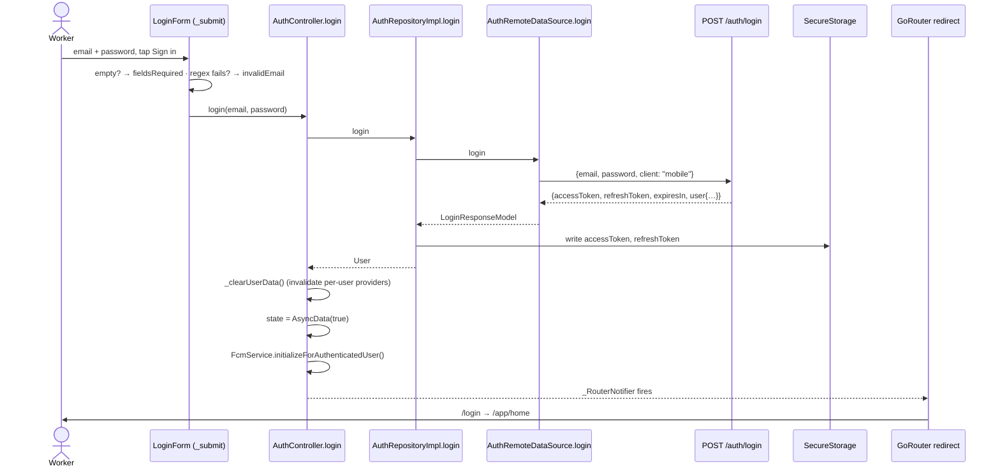
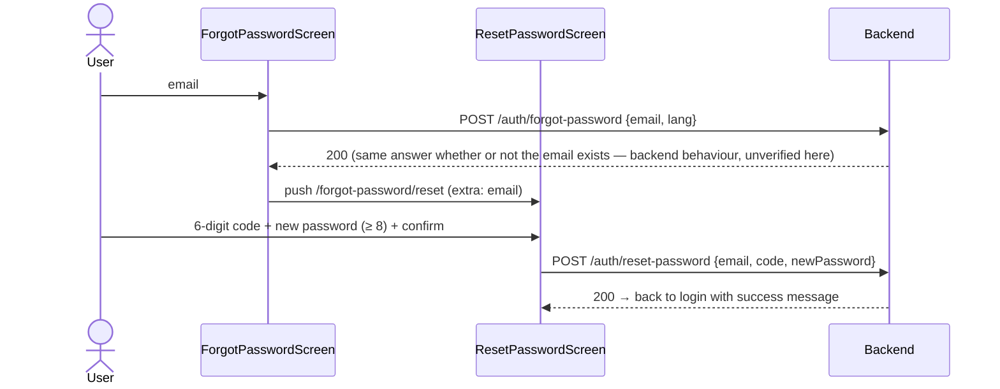

# 04 — Authentication and Storage

> **Last audited:** 2026-10-14 · **Updated:** 2026-10-18 (15-minute access token + refresh token; offline cache removed). Key files: `features/auth/**`, `core/storage/secure_storage_service.dart`, `core/storage/local_storage_service.dart`, `core/constants/storage_keys.dart`, `core/network/api_interceptor.dart`, `core/network/dio_client.dart`.
>
> No token or password value appears in this document.

---

## 1. Login flow



| Step | Code | Notes |
|---|---|---|
| Client validation | `widgets/login_form.dart` → `_submit()` | Both fields required; email regex `^[^@\s]+@[^@\s]+\.[^@\s]+$`. No password length rule on login (server decides). |
| Loading state | `_isSubmitting` in `LoginForm` state | Button disabled / spinner while true. |
| Request | `AuthRemoteDataSource.login` → `POST /auth/login` | Body `{email, password, client: 'mobile'}`. `client: 'mobile'` asks the backend for a 15-minute access token **plus** a refresh token. The dashboard doesn't send it and still gets one long-lived token. |
| Response parsing | `LoginResponseModel.fromJson` | Requires both `accessToken` and `refreshToken` as strings; otherwise throws `ApiException.generic()` → "Something went wrong". |
| Error display | `on ApiException catch (e)` → `e.localized(l10n)` | Server text (e.g. "Invalid email or password") is shown as sent; app-side errors (no connection, timeout) are translated. |
| Navigation | Not done by the form — comment: *"router will redirect based on auth state"* | Redirect rule: authenticated on `/login` → `/app/home`. |
| Previous user's data | `AuthController._clearUserData()` | Invalidates every per-user provider, so a new login never shows the last user's tasks. Nothing user-related is stored on the phone any more. |

**Role check:** the app does **not** restrict login by role (no `role ==` check in the auth flow). Role is only displayed (profile header, comment badges). Restricting who can sign in is the backend's job. *Confirmed by search.*

---

## 2. Session restoration (app restart)

Covered in [02 §1](02_STARTUP_AND_NAVIGATION.md). Summary of `AuthRepositoryImpl.validateSession()`:

| Situation | Result | User sees |
|---|---|---|
| No saved token | `false` | Login |
| `GET /auth/me` 200 (access token renewed on the way if expired) | `true` | Home |
| 401 or 403 (refresh rejected too) | both tokens deleted, `false` | Login |
| No connection, 5xx, timeout | rethrown, tokens kept | Splash error panel + Retry |

**Confirmed** by `test/session_test.dart` (3 startup tests).

---

## 3. Logout

`AuthController.signOut()` — order matters:

1. `state = AsyncLoading()`.
2. `fcmService.unregisterForLogout()` — **while the session is still valid**: `DELETE /me/device-token {token}`, then `FirebaseMessaging.deleteToken()`. Best effort, errors only logged.
3. `repository.logout()` — `POST /auth/logout {refreshToken}` so the server revokes the refresh token (best effort: logout works without a connection), then deletes `accessToken` and `refreshToken` from secure storage.
4. `_clearUserData()` — invalidates tasks, paging flags, profile, notifications, calendar, task details, comments.
5. `state = AsyncData(false)` → router guard sends any `/app/*` location to `/login`.

Settings (theme, language) and `hasSeenOnboarding` are **kept** after logout — they are device preferences, not user data.

---

## 4. Where data is stored

| Data | Storage | Key | Encrypted? | Cleared on logout? |
|---|---|---|---|---|
| Access token (JWT, 15 min) | `flutter_secure_storage` | `accessToken` | Yes — Android Keystore-backed / iOS Keychain (*inferred from plugin defaults; `const FlutterSecureStorage()` with no options*) | Yes |
| Refresh token (30 days, single use) | `flutter_secure_storage` | `refreshToken` | Yes (same) | Yes, and revoked on the server |
| Theme | SharedPreferences | `themeMode` (`light`/`dark`) | No | No |
| Language | SharedPreferences | `localeCode` (`en`/`ar`) | No | No |
| Onboarding seen | SharedPreferences | `hasSeenOnboarding` | No | No |
| Tasks, profile, notifications, comments | **Not stored** — memory only, reloaded from the API (offline cache removed 2026-10-18) | — | — | — |
| Password | **Not stored anywhere** | — | — | — |
| FCM device token | Managed by Firebase SDK; sent to backend | — | — | Deleted (`deleteToken`) |

### Secure storage vs SharedPreferences
- **Secure storage** = encrypted by the OS key store; slower, async; right for secrets (both tokens).
- **SharedPreferences** = plain XML (Android) / plist (iOS) in the app sandbox; fast, loaded synchronously at startup; right for preferences. It now holds only theme, language and the onboarding flag.

---

## 5. How the token reaches the server

`ApiInterceptor.onRequest` (`core/network/api_interceptor.dart`) reads `accessToken` from secure storage **on every request** and sets `Authorization: Bearer <token>` when present. Login itself is sent the same way (no token yet → no header).

The SSE stream (`RealtimeRemoteDataSource`) uses the same `dioProvider`, so it is authenticated — and renewed — the same way. *Confirmed — it reads `dioProvider`.*

`Image.network` for attachment thumbnails and the legal WebView do **not** send the token (they load public URLs). *Confirmed in `attachments_section.dart`, `legal_webview_screen.dart`.*

---

## 6. Silent token refresh (15-minute sessions)

The technique is called **silent token refresh with refresh-token rotation** (a *sliding session*).

```mermaid
sequenceDiagram
  participant App as Any request (Dio)
  participant I as ApiInterceptor.onError
  participant SS as SecureStorage
  participant API as Backend
  App->>API: GET /tasks (access token)
  API-->>I: 401 (access token older than 15 min)
  I->>I: only one refresh at a time (_refreshing)
  I->>SS: read refreshToken
  I->>API: POST /auth/refresh {refreshToken} (separate Dio, no interceptor)
  alt accepted
    API-->>I: {accessToken, refreshToken} (old refresh token now dead)
    I->>SS: save both
    I->>API: resend GET /tasks with the new token (once)
    API-->>App: 200 — the user noticed nothing
  else rejected (401)
    I->>SS: delete both tokens
    I->>I: onSessionExpired() → AuthController.sessionExpired()
    Note over App: state false → router → /login
  else no connection
    I-->>App: error shown; tokens kept, next request tries again
  end
```

| Rule | Where | Why |
|---|---|---|
| Access token lifetime 15 min | backend `MOBILE_ACCESS_TOKEN_SECONDS=900` | A stolen access token is only useful for minutes |
| Refresh token lifetime 30 days **from its last use** | backend `REFRESH_TOKEN_TTL_DAYS=30` | Each refresh issues a new 30-day token, so a worker who opens the app at least monthly stays signed in |
| Refresh tokens are single use | backend `RefreshTokenService.refresh` | Reusing an old one revokes all of the user's sessions (it means the token was copied) |
| One refresh at a time | `ApiInterceptor._refreshing` | Several requests failing together share one refresh instead of spending the single-use token twice |
| Resend only once | `extra['tokenRefreshRetried']` | No retry loops |
| Never refresh for `/auth/login`, `/auth/refresh`, `/auth/logout` | `_noRefreshPaths` | A wrong password (401) is not an expired session |
| Uploads can be resent | `FormData.clone()` | A multipart body can only be sent once |
| Only stored as a hash on the server | backend `RefreshToken.tokenHash` (SHA-256) | A database leak doesn't reveal usable tokens |

**When the user is sent to login** (the only cases):
1. 30 days without opening the app.
2. Password reset (the backend revokes all refresh tokens).
3. Account deactivated by an admin.
4. The user taps Log out.

**Confirmed** by `test/session_test.dart` (5 refresh tests: renew + resend, shared refresh, rejected → logout, no connection → tokens kept, wrong password not treated as expiry) and by an end-to-end run against the real backend on 2026-10-18 (12 checks, all passed).

---

## 7. Password reset (forgot password)


- Code field: `widgets/otp_code_field.dart` (`length = 6`, digits only).
- Resend: `widgets/resend_code_button.dart` (cool-down timer).
- `lang` is the app's language so the email is in Arabic or English.
- Actions live in `providers/password_reset_provider.dart` → `PasswordResetActions`.
- A reset ends every other session, including mobile refresh tokens.

## 8. Request an account

1. `SignupRequestScreen`: full name (≥ 2), email (regex), password (≥ 8) + confirm → `POST /signup-requests {fullName, email, password, lang}`.
2. `SignupVerifyScreen` (`extra: SignupDraft`): 6-digit code → `POST /signup-requests/verify {email, code}`.
3. `SignupResultView` tells the user the request now waits for an administrator. The account can only sign in after approval (backend + dashboard). *Mobile part Confirmed (`test/signup_request_test.dart`); approval flow Unverified (outside mobile).*

---

## 9. Defense answers in one line each

- *Where are the tokens?* Secure storage: `accessToken` (15 min) and `refreshToken` (30 days); `ApiInterceptor` adds the access token to every request.
- *Why not SharedPreferences for the tokens?* It isn't encrypted.
- *What happens when the access token expires?* The interceptor trades the refresh token for a new pair and resends the request; the user notices nothing.
- *What if a token is stolen?* An access token works for at most 15 minutes. A refresh token is single use; if the thief and the real app both use it, the server sees the reuse and ends every session of that user.
- *How do you stop user A seeing user B's data?* Nothing user-related is saved on the phone, and `_clearUserData` invalidates all per-user providers on login, logout and session end.
