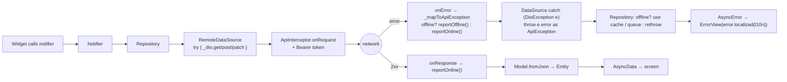

# 05 — API and Dio

> **Last audited:** 2026-10-14. Key files: `core/constants/api_constants.dart`, `core/network/dio_client.dart`, `core/network/api_interceptor.dart`, `core/network/api_exceptions.dart`, `core/network/api_exception_l10n.dart`, `features/*/data/datasources/*_remote_data_source.dart`.
>
> The backend is described only as the contract the app calls. Backend behavior is **Unverified** unless stated otherwise.

---

## 1. Configuration

| Setting | Value | Where |
|---|---|---|
| Base URL | `String.fromEnvironment('API_BASE_URL', defaultValue: 'http://192.168.0.101:3000')` | `ApiConstants.baseUrl` |
| Connect timeout | 15 s | `ApiConstants.connectTimeout` |
| Receive timeout | 15 s (SSE overrides to 60 s) | `ApiConstants.receiveTimeout`, `RealtimeRemoteDataSource.idleTimeout` |
| Default header | `Content-Type: application/json` | `dioProvider` |
| Auth header | `Authorization: Bearer <token>` if a token is stored | `ApiInterceptor.onRequest` |

- **Change the server without editing code:** `flutter run --dart-define=API_BASE_URL=http://<PC-IP>:3000` (emulator: `http://10.0.2.2:3000`). The value is baked in at **compile time**.
- **HTTP, not HTTPS.** The default is a LAN dev address over plain HTTP. Android allows cleartext only in the **debug** manifest — a release build cannot reach an `http://` server (doc 09, doc 10 H1).

### Why one Dio instance?
`dio_client.dart` says *"Single centralized Dio instance. Never create Dio elsewhere."* One place for the base URL, timeouts, auth header, error mapping and reachability reporting. Exception: `ConnectivityController.probe()` makes a separate short-timeout `Dio` on purpose (so the probe isn't reported twice and needs no token).

---

## 2. Endpoint inventory (everything the app calls)

| Method | Path | Caller (class → method) | Body / query | Response used |
|---|---|---|---|---|
| POST | `/auth/login` | `AuthRemoteDataSource.login` | `{email, password}` | `{accessToken, user{id,email,fullName,role}}` |
| GET | `/auth/me` | `AuthRemoteDataSource.validateSession` | — | status only |
| POST | `/auth/forgot-password` | `…requestPasswordReset` | `{email, lang}` | status only |
| POST | `/auth/reset-password` | `…resetPassword` | `{email, code, newPassword}` | status only |
| POST | `/signup-requests` | `…requestSignup` | `{fullName, email, password, lang}` | status only |
| POST | `/signup-requests/verify` | `…verifySignup` | `{email, code}` | status only |
| GET | `/me` | `ProfileRemoteDataSource` | — | profile JSON |
| PATCH | `/me` | `ProfileRemoteDataSource` | `{fullName}` | profile JSON |
| PATCH | `/me/password` | `ProfileRemoteDataSource` | `{currentPassword, newPassword}` | status only |
| POST | `/me/avatar` | `ProfileRemoteDataSource` | multipart `file` | ignored → profile reloaded |
| POST | `/me/device-token` | `FcmService._registerToken` | `{token}` | — |
| DELETE | `/me/device-token` | `FcmService.unregisterForLogout` | `{token}` | — |
| GET | `/tasks` | `TaskRemoteDataSource.getTasks` | `page`, `limit`, optional `from`/`to` (UTC ISO-8601) | `{data: [...], page, limit, total, totalPages}` → `TaskPageModel` (`task_model.dart`) |
| GET | `/tasks/:id` | `…getTaskById` | — | task JSON |
| PATCH | `/tasks/:id/status` | `…updateTaskStatus` | `{status}` (e.g. `IN_PROGRESS`) | task JSON |
| PATCH | `/tasks/:id/complete` | `…completeTask` | `TaskSubmissionModel.toJson()` — the screen sends `notes` + `checklistResults[{id,done}]` | task JSON |
| POST | `/tasks/:id/attachments` | `…uploadAttachment` | multipart `{kind: PHOTO|FILE, file}` | JSON map |
| GET | `/tasks/:id/comments` | `TaskCommentRemoteDataSource` | `page`, `limit` | paged comments |
| POST | `/tasks/:id/comments` | `TaskCommentRemoteDataSource.addComment` | `{body}` | comment JSON |
| GET | `/notifications` | `NotificationRemoteDataSource.getNotifications` | — | **JSON array** |
| PATCH | `/notifications/:id/read` | `…markRead` | — | — |
| PATCH | `/notifications/read-all` | `…markAllRead` | — | — |
| GET | `/events` | `RealtimeRemoteDataSource.connect` | `Accept: text/event-stream`, stream response | SSE events |
| GET | `/config/locales` | `ConnectivityController.probe` | — | any HTTP answer = online |
| (WebView) | `/legal/page?slug=&lang=` | `LegalWebViewScreen` | — | HTML page |
| (image) | attachment `url` from task JSON | `Image.network` in `attachments_section.dart` | — | image bytes |

Backend maximum page size used by the app: **100** (`TaskRepositoryImpl.refreshAllTasks`, `getTasksInRange`: comment `// backend maximum`).

---

## 3. The request pipeline



Every remote data source method uses the same pattern:
```dart
try {
  final response = await _dio.get<Map<String, dynamic>>(...);
  final data = response.data;
  if (data == null) throw const ApiException.generic();
  return SomeModel.fromJson(data);
} on DioException catch (e) {
  if (e.error is ApiException) throw e.error as ApiException;
  throw const ApiException.generic();
}
```
So **above the data-source layer, only `ApiException` exists** — the comment in `api_exceptions.dart` says *"UI code should only ever catch this — never a raw DioException."*

---

## 4. Error mapping

`ApiInterceptor._mapToApiException(DioException)`:

| `DioExceptionType` | `ApiErrorKind` | Message key shown (`localized`) | Queued offline? |
|---|---|---|---|
| `connectionTimeout` | `offline` | `errorOffline` | **Yes** |
| `connectionError` | `offline` | `errorOffline` | **Yes** |
| `sendTimeout`, `receiveTimeout`, `transformTimeout` | `timeout` | `errorTimeout` | No (request may have arrived → avoid duplicates) |
| `badCertificate` | `certificate` | `errorCertificate` | No |
| `cancel` | `cancelled` | `errorCancelled` | No |
| `badResponse` with `{message}` body | `server` (+ `statusCode`) | the backend's own text; **5xx → `genericError`** | No |
| `badResponse` without message | `generic` (+ `statusCode`) | `genericError` | No |
| `unknown` | `generic` | `genericError` | No |

- `message` arrays (NestJS validation) are joined with `", "`.
- Helpers on `ApiException`: `isUnauthorized` (401), `isForbidden` (403), `isNotFound` (404), `isServerError` (≥ 500), `isOffline`.
- `ApiExceptionL10n.localized` (`api_exception_l10n.dart`) translates app-side errors; **server text is shown as received** — so a 4xx message from the backend appears in the backend's language (the app sends `lang` only on email endpoints).

### Reachability as a side effect
`onResponse` and `onError` (with a response) call `reportOnline()`; offline errors call `reportOffline()`. `ConnectivityController` then probes `/config/locales` every 15 s and on app resume until the server answers. There is **no `connectivity_plus` plugin**: "online" means *the TaskFlow server answered*, not "Wi-Fi is on" (comment in `connectivity_provider.dart`).

---

## 5. Pagination contract

- `GET /tasks?page=N&limit=20` → `TaskPage{tasks, page, limit, total, totalPages}`.
- `TasksController.loadNextPage()` appends page `_page + 1` while `_page < _totalPages`; it is triggered when `_scrollController.position.extentAfter < 300` in `TasksScreen`; failures set `tasksLoadMoreFailedProvider` (footer shows Retry).
- Offline: `TaskRepositoryImpl.getTasks` returns **all cached tasks as one page** (`totalPages: 1`), and page > 1 rethrows.

**Confirmed** by `test/tasks_pagination_test.dart` (5 tests).

---

## 6. Multipart uploads

`TaskRemoteDataSource.uploadAttachment`: `FormData.fromMap({'kind': kind, 'file': await MultipartFile.fromFile(filePath)})`. Dio sets the multipart content type, overriding the JSON default. No upload progress callback (`onSendProgress`) is used; the UI shows an indeterminate "Uploading…" state. Files picked while offline are first copied by `OfflineFiles.keep()` so the queued path survives cache cleanup.

---

## 7. Server-Sent Events

`RealtimeRemoteDataSource.connect(cancelToken)`:
- `GET /events`, `responseType: ResponseType.stream`, `Accept: text/event-stream`, `receiveTimeout: 60 s` (server heartbeat every 25 s per the code comment — *backend behavior unverified*).
- Bytes → `utf8.decoder` → `LineSplitter` → `parseServerSentEvents` (joins `data:` lines until a blank line) → `RealtimeEvent{type: task|comment|notification|ping|unknown, taskId}`.
- Consumer: `RealtimeController` (doc 06 §Realtime). **Confirmed** by `test/realtime_test.dart` (7 tests, including parser cases).

---

## 8. Tap-to-UI trace: "Mark all notifications read"

1. `NotificationsScreen` app bar action → `ref.read(notificationsControllerProvider.notifier).markAllRead()`.
2. Controller sets every item `isRead = true` **immediately** (optimistic) → list and bell badge (`unreadNotificationCountProvider`) update.
3. Repository → `PATCH /notifications/read-all` (or queues `markAllNotificationsRead` if offline).
4. If the call throws, `markAllRead` restores the previous list and rethrows (**Confirmed** in `NotificationsController.markAllRead`). `markRead` (single) only logs failures — opening the task matters more.

---

## 9. What is **not** implemented (say it plainly)

| Missing | Effect |
|---|---|
| Automatic retry for failed online requests | User retries via buttons/pull-to-refresh; only queued offline writes retry automatically |
| Global 401 handling / token refresh | See doc 04 §6 |
| Request de-duplication / idempotency keys | A receive timeout on a write is not re-sent automatically, to avoid duplicates |
| Certificate pinning | Not present (and the dev server is HTTP) |
| Response caching layer in Dio | Caching is done in repositories via `OfflineStore` instead |
