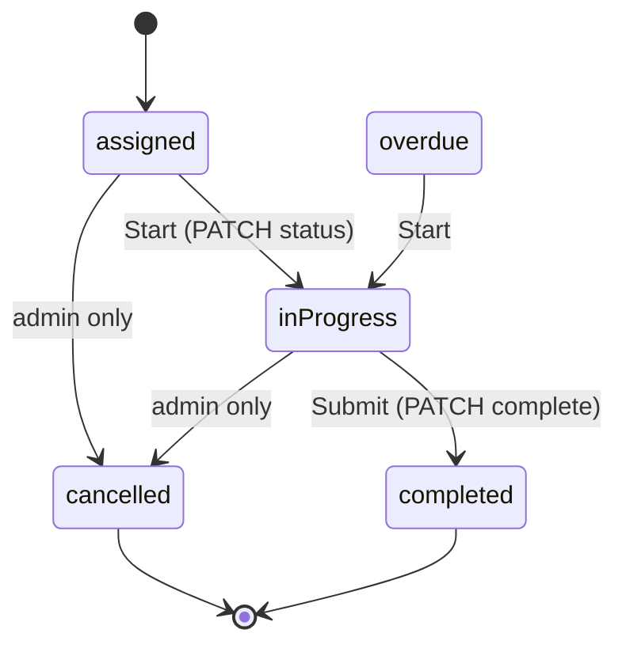
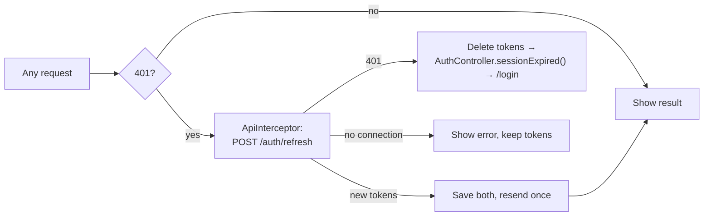

# 06 — Features Walkthrough

> **Last audited:** 2026-10-14 · **Updated:** 2026-10-18 (offline mode removed; 15-minute sessions with silent refresh). Each feature uses the same 13-point card:
> 1 Purpose · 2 Entry point · 3 Screens · 4 Key widgets · 5 State · 6 Data layer · 7 API · 8 No connection · 9 Loading / empty / error · 10 Localization · 11 Tests · 12 Status · 13 Limitations.
>
> Status values: **Full** (complete for its intended scope), **Partial** (works, with notable gaps), **Demo** (UI only, fake data), **Missing**.
>
> Since 2026-10-18 the app always needs the server. With no connection a screen shows "No internet connection" with Retry (or pull-to-refresh); nothing is saved for later.

---

## Status overview

| Feature | Status | One-line reason |
|---|---|---|
| Splash | Full | Destination logic, 6 s minimum, error + Retry |
| Onboarding | Full | 3 pages, shown once |
| Login | Full | Validation, errors, 15-minute session renewed silently |
| Forgot / reset password | Full (mobile side) | Email delivery depends on backend SMTP — *Unverified on device* |
| Request an account | Full (mobile side) | Approval happens in the admin dashboard — outside scope |
| Bottom navigation | Full | 4 tabs, independent stacks |
| Home dashboard | Partial | Statistics only cover **loaded** task pages |
| Task list | Full | Paging, search, filters, pull-to-refresh |
| Task details | Full | Hero, info, checklist (read-only), attachments, comments, actions |
| Start / complete task | Partial | Minimum photo/file counts **not enforced**; a few English-only strings |
| Comments | Full | Paged, post a comment |
| Calendar | Full | Month view, markers, per-day list |
| Notifications (in-app) | Full | List, read state, badge, routing |
| Push notifications | Partial | Android configured; **iOS not configured** |
| Profile | Full | Edit name, photo, password, logout |
| Settings | Partial | Theme + language; notification preferences **missing** |
| Legal pages | Full | WebView with progress, reload, open in browser |
| Session renewal | Full | 15-minute access token, rotating 30-day refresh token |
| Live updates (SSE) | Full (mobile side) | Needs backend `/events` |
| Offline mode | **Removed** (2026-10-18) | The app now always talks to the server |

No feature uses fake/demo data. *Confirmed* — no mock repositories in `lib/` (fakes exist only in `test/`).

---

## Splash
1. Show the brand while deciding where to go. 2. `initialLocation: /splash`. 3. `splash/screens/splash_screen.dart`. 4. `SplashErrorPanel`, logo + title. 5. `splashControllerProvider` (`AsyncNotifier<String>`). 6. `SharedPreferences` flag + `AuthController.validateSession`. 7. `GET /auth/me` (if token; an expired access token is renewed on the way). 8. No connection → error panel + Retry, tokens kept. 9. Error panel + Retry (`ref.invalidate`). 10. Localized strings. 11. `widget_test.dart` (3 timing assertions), `session_test.dart`. 12. **Full**. 13. 6 s fixed minimum delays every start, even for returning users (a product choice).

## Onboarding
1. Explain the app on first launch. 2. Splash when `hasSeenOnboarding` is false. 3. `onboarding_screen.dart`. 4. `PageView` pages + dots + Skip/Next/Get started. 5. `onboardingControllerProvider` (`Notifier<bool>`). 6. SharedPreferences. 7. None. 8. Works without a connection (no API calls). 9. — 10. en/ar. 11. `widget_test.dart`. 12. **Full**. 13. Two onboarding widgets are unused (`onboarding_background_painter.dart`, `onboarding_brand_mark.dart`).

## Login
See doc 04 §1. 11. `login_layout_test.dart` (layout at small width / large text), `session_test.dart`. 12. **Full**. 13. No biometric login. The session stays signed in as long as the app is opened at least every 30 days.

## Forgot / reset password
See doc 04 §7. 11. No dedicated test. 12. **Full (mobile)**. 13. Code entry relies on email delivery — *Unverified*.

## Request an account
See doc 04 §8. 11. `signup_request_test.dart`. 12. **Full (mobile)**.

## Bottom navigation
3. `main_navigation/screens/main_navigation_screen.dart`. 4. `NavigationBar`. 5. `StatefulNavigationShell`; `MainNavigationScreen.build` calls `ref.watch(realtimeProvider)` (live updates exist only while the signed-in shell is shown). **Confirmed**. 12. **Full**.

## Home dashboard
1. Today's work at a glance. 2. Tab 1. 3. `home/screens/home_screen.dart`, `due_today_screen.dart`. 4. `WelcomeHeader`, `NotificationBellButton`, `TopKpiCarousel`, `TodayTasksSection`, `MyProgressSection`, `PriorityBreakdownRow`, `ProgressMetricCard`. 5. `homeOverviewProvider` = `tasksControllerProvider.whenData(HomeOverview.fromTasks)`. 6. No own repository. 7. Indirect (`GET /tasks`). 8. Error state with Retry from the task list. 9. Skeleton/error from the task list's `AsyncValue`. 10. en/ar. 11. `home_overview_test.dart` (on-time rate rules). 12. **Partial**. 13. **Counts only cover tasks already loaded** (first 20 until the user scrolls Tasks) — with more than 20 tasks, KPIs can be lower than reality. Fix would be a backend summary endpoint.

**Metrics defined in `HomeOverview.fromTasks`:**
| Metric | Rule |
|---|---|
| Due today | active (not completed/cancelled) tasks whose local deadline date is today |
| Overdue | status `overdue` **or** active and past deadline |
| This week | tasks created since Monday; completed among them |
| On-time rate | last 30 days: completed on/before deadline ÷ (tasks completed in window + tasks whose deadline passed in window). Open-and-late counts as missed. Cancelled / no deadline excluded. Null if nothing qualifies |
| Priority counts | all loaded tasks per priority |

## Task list
1. All tasks assigned to the worker. 2. Tab 2. 3. `tasks/screens/tasks_screen.dart`. 4. `TaskSearchBar`, `TaskFilterBar`, `TaskCard`, `TaskCardSkeleton`, `TaskPriorityLegend`. 5. `tasksControllerProvider`, `tasksLoadingMoreProvider`, `tasksLoadMoreFailedProvider`. 6. `TaskRepositoryImpl.getTasks`. 7. `GET /tasks?page&limit=20`. 8. `ErrorView` + Retry. 9. Skeleton cards; `EmptyState`; `ErrorView` + Retry; footer spinner / Retry for next page. 10. `Task.titleFor(languageCode)` / `descriptionFor(languageCode)` show the Arabic text when the app is in Arabic and the task has it (**Confirmed**: `task_card.dart`, `task_details_hero.dart`, `calendar_task_tile.dart`); search also matches `titleAr`. 11. `tasks_pagination_test.dart`, `ui_robustness_test.dart`. 12. **Full**. 13. **Search and filters run on the client over loaded pages only**; the backend is not asked to search.

## Task details
1. Everything about one task. 2. Tap a card, a notification or a push. 3. `task_details_screen.dart`. 4. `TaskDetailsHero`, `TaskDetailsBody`, `TaskInfoRow`, `TaskChecklist` (read-only), `AttachmentsSection`, `TaskCommentsSection`, `TaskActionBar`. 5. `taskDetailsControllerProvider(id)` (family). 6. `getTaskById`. 7. `GET /tasks/:id`. 8. Error + Retry; on pull-to-refresh the current task stays on screen. 9. `reload()` keeps the current task on screen unless the error is 403/404 (task removed or reassigned). 10. en/ar. 11. No dedicated test. 12. **Full**. 13. Attachments open via `launchUrl` (external app); thumbnails use `Image.network` without auth.

## Start / complete task

- **Start:** `TaskActionBar` shows "Start" for `assigned`/`overdue` → `updateStatus(inProgress)` → `PATCH /tasks/:id/status`.
- **Complete:** "Complete task" (only `inProgress`) → `CompleteTaskScreen`.
  - Photos (camera/gallery via `image_picker`) and files (`file_picker`) **upload immediately when picked** (`TaskDetailsController.uploadAttachment` → `POST /tasks/:id/attachments`, kind `PHOTO`/`FILE`).
  - Checklist ticked in `CompletionForm`; notes optional.
  - `_canSubmit`: status is `inProgress`, checklist complete if `requiresChecklist`, no upload running.
  - Submit → `complete(TaskSubmissionModel(notes, checklistResults))` → `PATCH /tasks/:id/complete` → back to details + "Task completion submitted."
- 8. No connection: the upload or submit fails with a message ("Could not upload the photo…", "Could not submit the task…") and the worker tries again. 11. No dedicated test. 12. **Partial**. 13. `minPhotosRequired`/`minFilesRequired` exist on `Task` but are **not enforced** in the app (deliberately optional per project history — say so). Uploads happen before submit, so abandoned uploads remain on the server. English-only strings: upload result snackbars in `complete_task_screen.dart`, "Uploading…" in `completion_form.dart`.

## Comments
1. Talk with admins/managers about a task. 3. Section on task details (`focus=comments` scrolls to it). 4. `TaskCommentList`, `TaskCommentTile` (role badge for ADMIN/MANAGER), `TaskCommentInput`, `TaskCommentsEmptyState`. 5. `taskCommentsControllerProvider(id)` — `autoDispose.family`, page size 20, oldest first, `loadMore`, `refresh` keeps old list on error. 6. `TaskCommentRepositoryImpl` (calls the API). 7. `GET/POST /tasks/:id/comments`. 8. Sending fails with "Could not send your comment"; the text stays in the field. 12. **Full**.

## Calendar
1. See tasks by day. 2. Tab 3. 3. `calendar_screen.dart`. 4. `TaskMonthCalendar` (`table_calendar`), `CalendarDayMarkers`, `CalendarLegend`, `CalendarDayTasks`, `CalendarTaskTile`. 5. `calendarFocusedMonthProvider`, `calendarSelectedDayProvider`, `calendarMonthTasksProvider(month)` (family), `calendarEntriesProvider`. 6. `getTasksInRange` — fetches **all pages** (limit 100) for the month. 7. `GET /tasks?from&to`. 8. "Could not load tasks for this month" + Retry. 9. Uses `valueOrNull` so a failed month doesn't crash the screen. 11. `calendar_screen_test.dart`. 12. **Full**.

## In-app notifications
3. `notifications/screens/notifications_screen.dart` (from the bell). 5. `notificationsControllerProvider`, `unreadNotificationCountProvider`, `notificationOpenerProvider`. 6. `NotificationRepositoryImpl` (calls the API). 7. `GET /notifications`, `PATCH …/:id/read`, `PATCH …/read-all`. 8. "Mark all as read" restores the list and shows an error if the call fails. **Routing rules (`NotificationOpener.open`):** daily summary → Calendar tab; `taskUnassigned` or no task → nothing; comment → task details with `focusComments`; otherwise task details (details provider invalidated first so it reloads). 12. **Full**.

## Push notifications
See doc 09. 12. **Partial** — Android only.

## Profile
3. `profile_screen.dart`. 4. `ProfileHeader` (+ skeleton), `ProfileStatCard`, `EditNameDialog`, `ChangePasswordDialog`, `ProfileLogoutButton`. 5. `profileControllerProvider`. 6. `ProfileRepositoryImpl` (calls the API). 7. `GET/PATCH /me`, `PATCH /me/password`, `POST /me/avatar`. 8. Edits fail with a message. Logout works without a connection (the server-side revoke is best effort). 12. **Full**.

## Settings and language
3. `settings_screen.dart`, `language_screen.dart`. 4. `ThemeSelector` (light/dark only), `LanguageSelector`, `LegalLinkTile`. 5. `settingsControllerProvider`. 6. SharedPreferences `themeMode`, `localeCode`. 8. Works without a connection (device settings). 12. **Partial**. 13. No notification preferences (users can't turn notification types on or off in the app).

## Legal pages (Terms / Privacy / About)
3. `features/about/widgets/legal_webview_screen.dart` (route `/app/profile/legal/:slug`). 4. `WebViewWidget`, `LinearProgressIndicator`, reload and "open in browser" actions (`url_launcher`). 7. `GET /legal/page?slug=&lang=` (HTML; content edited in the admin dashboard). JavaScript disabled. 8. "Unable to load this page…" + Reload. 12. **Full**.

## Session renewal (silent token refresh)

- Access token: 15 minutes. Refresh token: 30 days from its last use, single use (rotated on every refresh).
- Several requests failing at once share one refresh. A request is resent at most once. Login/refresh/logout calls are never refreshed (a wrong password isn't an expired session).
- The user is sent to login only after 30 days without opening the app, a password reset, deactivation by an admin, or logout.
- 11. `session_test.dart` (5 refresh tests) + a 12-check run against the real backend (2026-10-18). 12. **Full**. Details in doc 04 §6.

## Live updates (Server-Sent Events)
- `RealtimeController` connects to `GET /events` while the app is in the foreground and the signed-in shell is shown.
- Events: `task` → reload the loaded task pages (`reloadQuietly`) + calendar + open details of those ids; `comment` → refresh that thread if open (`ref.exists`); `notification` → refresh list; `ping` ignored.
- 400 ms debounce batches bursts. Reconnect backoff 2 s → 5 s → 10 s → 30 s. Catch-up reload after reconnect. Disconnects on pause, reconnects on resume. If the stream gets a 401, the interceptor renews the token first; only a real session end (401/403 after refresh) stops it.
- 11. `realtime_test.dart` (7). 12. **Full (mobile)** — needs backend `/events` (*Unverified here*).
