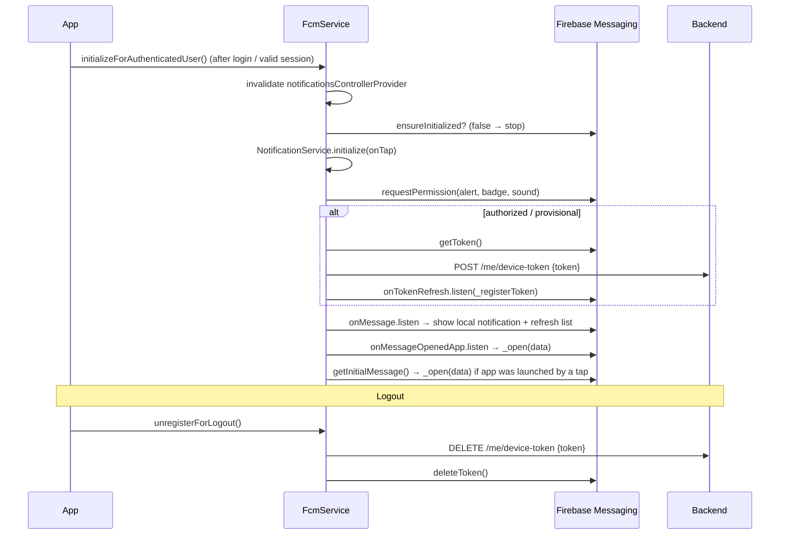

# 09 — Firebase, Device Features and Android

> **Last audited:** 2026-10-14. Key files: `core/notifications/firebase_bootstrap.dart`, `fcm_service.dart`, `notification_service.dart`, `android/app/build.gradle.kts`, `android/app/src/{main,debug,profile}/AndroidManifest.xml`, `ios/Runner/Info.plist`.
>
> Firebase project identifiers and API keys exist in `android/app/google-services.json`; they are **not reproduced** here.

---

## 1. Firebase setup

| Item | State | Evidence |
|---|---|---|
| Android config | Present | `android/app/google-services.json`; plugin `com.google.gms.google-services` in `build.gradle.kts` |
| iOS config | **Missing** | no `ios/Runner/GoogleService-Info.plist` |
| `firebase_options.dart` (FlutterFire CLI) | Not used | `Firebase.initializeApp()` is called with no options → reads the native config files |
| Initialisation | `FirebaseBootstrap.ensureInitialized()` — memoised `Future<bool>` (`_ready ??= _initialize()`), started un-awaited in `main()` | Confirmed |
| Failure behavior | Returns `false`, logs "Firebase is not configured; push notifications are disabled" → app continues without push | Confirmed |

Why not await Firebase in `main()`? The comment in `firebase_bootstrap.dart`: on a first launch Firebase can take a few seconds and Android would show only its plain launch screen until the first frame.

---

## 2. Push notification lifecycle

### The three app states
| App state | Who shows the notification | What happens on tap |
|---|---|---|
| Foreground | `onMessage` → `NotificationService.showRemoteMessage` (local notification on channel `taskflow_updates`, high importance) + in-app list refresh | local-notification `onTap` → `_handlePayload` → `_open` |
| Background | The system tray shows messages that carry a `notification` payload. Data-only messages are shown by `firebaseMessagingBackgroundHandler` (`@pragma('vm:entry-point')`, top-level) | `onMessageOpenedApp` → `_open` |
| Terminated | Same as background | `getInitialMessage()` at startup → `_open`; local-notification launch payload via `handleLaunchPayload()` |

`_open(data)` → `NotificationOpener.openFromPayload` (marks read, decides destination) → `router.go(path)` (always `go`, because from the tray there is no screen to push onto). Rules are in doc 06.

### Android notification look
`AndroidManifest.xml` meta-data: default icon `@drawable/ic_stat_taskflow`, default color `@color/notification_accent`, default channel `taskflow_updates`. Same channel id is created in `NotificationService` → consistent sound/importance.

### Permission
`requestPermission` triggers the Android 13+ `POST_NOTIFICATIONS` dialog (permission merged from the plugin). If denied, the token is not registered — no push, but the in-app list still works.

### Verification status
Push delivery end-to-end needs the backend's Firebase service account and a real device → **Unverified** in this audit (it worked during development per project history, but that is not a test).

---

## 3. Device features

| Feature | Package | Where | Notes |
|---|---|---|---|
| Camera / gallery photos | `image_picker` | `CompleteTaskScreen` via `PhotoSourceSheet`; profile avatar | Android needs no manual permission for the system picker. **iOS needs `NSCameraUsageDescription` and `NSPhotoLibraryUsageDescription` — missing → crash on iOS** |
| Files | `file_picker` | `CompleteTaskScreen` | System document picker |
| Open links / attachments | `url_launcher` | `attachments_section.dart`, legal "open in browser" | Opens external apps |
| WebView | `webview_flutter` | `LegalWebViewScreen` | `JavaScriptMode.disabled` |
| Secure storage | `flutter_secure_storage` | token | Keystore / Keychain |
| Local notifications | `flutter_local_notifications` | `NotificationService` | channel `taskflow_updates` |

Not used: location/GPS, biometrics, background services, connectivity plugin, local file storage (offline mode removed 2026-10-18).

---

## 4. Android project configuration

| Setting | Value | Comment |
|---|---|---|
| `namespace` / `applicationId` | `com.example.taskflow_mobile` | ⚠ placeholder; Play Store rejects `com.example` and the id can't change after publishing |
| `minSdk` / `targetSdk` / `compileSdk` | `flutter.*` defaults | not pinned in the project |
| Java / Kotlin target | 17 | |
| Core library desugaring | enabled (`desugar_jdk_libs:2.1.4`) | needed by `flutter_local_notifications` (*Inferred from the plugin's setup guide*) |
| `release.signingConfig` | `signingConfigs.getByName("debug")` | ⚠ release APK is signed with the **debug key** |
| App label | `TaskFlow` | iOS display name is "Taskflow Mobile" (inconsistent) |
| Launch theme | `LaunchTheme` → gradient `launch_background.xml`; `values-v31`/`values-night-v31` for Android 12+ | |
| Minify / R8 rules | not configured in `build.gradle.kts` | Flutter defaults apply |

### Permissions (merged from plugins; the main manifest declares none itself)
`INTERNET`, `ACCESS_NETWORK_STATE`, `WAKE_LOCK`, `VIBRATE`, `POST_NOTIFICATIONS`, `com.google.android.c2dm.permission.RECEIVE`, plus the AndroidX-generated `com.example.taskflow_mobile.DYNAMIC_RECEIVER_NOT_EXPORTED_PERMISSION`. *Confirmed from the merged release manifest in `build/app/intermediates/merged_manifest/release/…` (a build artifact present at audit time).*

### 🚨 Cleartext HTTP — release blocker
- `android/app/src/debug/AndroidManifest.xml`: `<application android:usesCleartextTraffic="true" />` — **debug only**.
- `main` and `profile` manifests: no cleartext flag, no `networkSecurityConfig`.
- Since Android 9 (API 28) cleartext is **blocked by default**. The default API URL is `http://192.168.0.101:3000`.
- **Effect:** a `flutter build apk --release` / `flutter run --release` build **cannot reach the backend**; every request fails as a connection error → login shows "No internet connection".
- Fix options (for the team, not done in this audit): serve the API over **HTTPS** (correct for production), or add a `network_security_config.xml` that allows cleartext only for the dev host.

*Status: Confirmed by reading the three manifests and the merged debug/release manifests.*

---

## 5. iOS status (not a target so far)

| Item | State |
|---|---|
| `GoogleService-Info.plist` | missing → push disabled on iOS (Firebase init returns false) |
| `NSCameraUsageDescription`, `NSPhotoLibraryUsageDescription` | missing → `image_picker` crashes when opened |
| APNs capability / push entitlement | not verified |
| `CFBundleDisplayName` | "Taskflow Mobile" |
| Builds on macOS only | not built in this audit (*Unverified*) |

---

## 6. How to explain it in the defense

*"Push is FCM. After login the app asks permission, sends its device token to `POST /me/device-token`, and removes it on logout with `DELETE`. Foreground messages are shown as local notifications on our `taskflow_updates` channel; taps in any app state go through one `NotificationOpener`, so the in-app list and the tray behave the same. Firebase starts in the background so it never blocks the splash, and if it isn't configured the app works without push. Android is configured; iOS still needs its Firebase file and permission strings. And the release build currently needs HTTPS or a network-security config, because Android blocks plain HTTP outside debug."*
